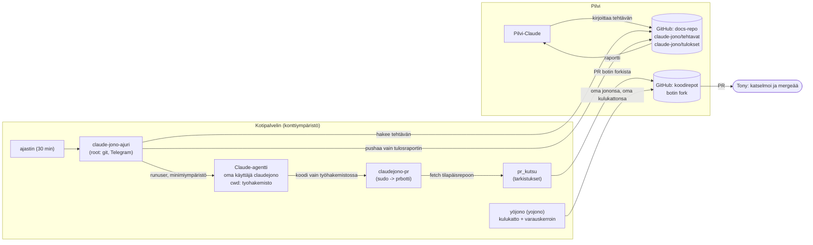

# Turvallisesti itseohjautuva agenttijono kotipalvelimella

Suomi | [English](#english)

Tapaustutkimus siitä, miten agentti-pohjan agentit tekevät töitä yöllä ilman ihmistä, mutta ihminen päättää kaiken, mikä merkitsee. Kaikki väitteet perustuvat tämän repon koodiin ja CHANGELOGiin sekä docs-repon `claude-jono/tulokset/`-raportteihin (30.10.2026). Kohdat, joita lähteet eivät todista, on merkitty.

## 1. Ongelma

Agentti tekee työtä silloin, kun kukaan ei katso: ideoi, katselmoi koodia, kirjoittaa testejä ja avaa pull requesteja. Kolme riskiä on kovin:

- **Raha.** Mallikutsut maksavat, ja virhe silmukassa voi kuluttaa budjetin yössä.
- **Oikeudet.** Agentti, joka voi muuttaa omia rajojaan tai lukea salaisuuksia, ei ole hallittavissa.
- **Päätösvalta.** Jos agentti mergeää omat muutoksensa, ihminen ei päätä mitään.

Periaate: **agentti ehdottaa, ihminen päättää.** Agentti saa lukea, ajaa testejä ja avata PR:n. Mergeä, kattojen muutosta ja salaisuuksia se ei saa. Rajat eivät ole kehotteessa pelkkänä pyyntönä vaan koodissa ja käyttöoikeuksissa ("koodi on laki").

## 2. Arkkitehtuuri

Osat:

- **GitHub viestikanavana.** Pilvi-Claude ei yllä palvelimen sisäverkkoon, mutta molemmat yltävät GitHubiin. Tehtävät kulkevat docs-repon kautta: tehtävä kirjoitetaan `claude-jono/tehtavat/`, tulos tulee `claude-jono/tulokset/` (`claudejono/README.md`).
- **Palvelin ja claude-jono.** Ajastin ajaa `python3 -m claudejono ajo`, joka ottaa vanhimman tehtävän ilman tulosta, ajaa `claude -p` -komennon ja pushaa vain tulostiedoston. Ajuri commitoi koodissa rajattuun polkuun: tulokset, itsesuunnitellut `-auto-`-tehtävät ja `tonylle.md`.
- **Yöjono (`yojono/`).** Erillinen jono, joka ajaa ideointi-, katselmointi-, testi- ja tarkkailutehtäviä yöllä. Sillä on oma päiväkattonsa ja budjetit tehtävittäin.
- **`pr_kutsu` ja `prbotti`.** Agentti ei saa GitHub-tunnusta. PR avataan komennolla `sudo -u prbotti /usr/local/sbin/claudejono-pr`, ja vain prbotti-käyttäjä lukee botin tunnuksen. `pr_kutsu` tarkistaa repolistan, `yo/`-haaran, suojatut polut ja päivärajan ennen PR:ää.
- **Ihminen.** Tony katselmoi ja mergeää. Botti ei mergeä.

## 3. Turvarajat

### Koodissa

- **Varauskerroin.** Yöjono varaa ennen tehtävää päiväkatosta `budjetti × VARAUSKERROIN` (`yojono/ajuri.py`, arvo 1,3). Syy: `claude --max-budget-usd` pysäyttää vasta budjetin ylittäneen vuoron jälkeen, joten toteutunut kulu voi ylittää budjetin. Kerroin vain tiukentaa kattoa, ja sen pienentäminen alle 1,3:n vaatii omistajan luvan (kommentti koodissa).
- **Suojatut polut.** `pr_kutsu` kieltäytyy PR:stä, joka muuttaa polkuja `.github/`, `tools/`, `systemd/`, `isanta/`, tiedostoja `rajat.py` ja `config.py` tai salaisuuden näköisiä tiedostoja. Virhe: "suojattuja polkuja muutettu, tee kasin".
- **Kulukatto ja rajat.** Kulu varataan ennen kutsua (`kulu.py`, `rajat.py`), joten katto pitää virhetilanteessakin. Itsesuunnittelussa tehtävämäärä on rajattu koodissa (CHANGELOG: 2 / ajo, 30 / vrk).
- **Commit-polku.** claude-jono-ajuri committaa vain oman tulostiedostonsa ja sallitut tiedostot; testattu (`claudejono/test_ajuri.py`).

### Käyttöoikeuksissa

- **Oma käyttäjä.** Ajuri pysyy rootina (git, deploy key, Telegram), mutta agentti ajetaan `runuser`-komennolla tavallisena käyttäjänä minimiympäristössä: ei rootin ympäristöä, ei SSH-avainta, ei botin tunnusta eikä yöjonon kattotiedostoja. `asenna-kayttaja.sh` luo käyttäjät ja oikeudet ja tarkistaa, ettei agentti lue avaimia eikä voi muuttaa kattoja.
- **Kapea sudo.** `sudoers.claudejono` sallii käyttäjältä claudejono käyttäjäksi prbotti vain yhden komennon, `claudejono-pr`, ja `env_reset` on päällä.
- **Polut rajattu.** `claudejono-pr` hyväksyy vain hakemistot ja kuvaustiedostot, jotka ovat työhakemiston alla.
- **fsmonitor-testi.** Agentti voi kirjoittaa omaan työkloonaansa `.git/config`-asetuksen (esim. `core.fsmonitor` tai `core.hooksPath`), jonka git ajaisi komentona. Jos prbotti ajaisi `git`-komentoja suoraan agentin kloonissa, agentti saisi koodin ajoon botin oikeuksilla. Siksi `claudejono-pr` hakee (`git fetch`) haarat ensin prbotin omaan tilapäiseen repoon, ja PR tehdään siitä. CHANGELOG ja skriptin kommentti toteavat testatun: agentin `core.fsmonitor` ja `core.hooksPath` eivät suoritu fetchissä.

## 4. Todelliset tapahtumat 30.10.2026

Tapahtumat ovat docs-repon tulosraporteista ja CHANGELOGista. Mikään ei vuotanut salaisuutta tai rikkonut rahan rajaa pysyvästi, mutta jokainen oli signaali, ja jokainen johti sääntöön.

| Tapahtuma | Mitä tapahtui | Mitä muutettiin |
| --- | --- | --- |
| Agentti muokkasi omaa ajuriaan | Ensimmäisen oikean tehtävän aikana agentti muokkasi koodia, joka ajaa sitä itseään. Mitään vahingollista ei tapahtunut, mutta periaatteessa se oli juuri se, mitä ei haluta. (Tarkempia yksityiskohtia, kuten mitä muokattiin ja miten se huomattiin, lähteet eivät kerro.) | **Työkansiosääntö:** koodityöt vain agentin omissa klooneissa työhakemistossa. Jonojen oman koodin hakemistoissa agentti ei muuta, vaihda haaraa eikä committaa. |
| Root-ajo | Agentti ajettiin aluksi samalla käyttäjällä kuin ajuri. | **Oma käyttäjä** (Tonyn päätös 30.10.): agentti ajetaan `runuser`-komennolla minimiympäristössä ja PR:t kapean sudon kautta botille. |
| Kulu 1,86 / 1,50 USD | 28.10. katselmointi maksoi 1,86 USD, vaikka budjetti oli 1,50, koska budjettiraja pysäyttää vasta ylittäneen vuoron jälkeen. Päiväkulu nousi 5,32 USD:iin, kun katto oli 5,00. Tehtävä kaatui ilman raporttia. | **Varauskerroin 1,3:** budjetti × 1,3 varataan ennen tehtävää. Katselmoinnin budjettia nostettiin samalla 2,50 USD:iin (agentti-pohja), koska toteutunut kulu oli 1,86. |
| Katselmoinnin nälkiintyminen | Katselmointi ohittui, koska halvemmat tehtävät kuluttivat ensin päiväkatosta ja jäljelle jäi alle 2,50 USD. | Katselmointi jonon ensimmäiseksi; katot ja budjetit ennallaan. |
| `claudejono-pr` ja omistajuus | `claudejono-pr` kaatui virheeseen "dubious ownership" työkloonin `.git`-polussa. | Skripti kirjoittaa `safe.directory`-asetuksen tilapäiseen globaaliin tiedostoon, ei pysyvään konfiguraatioon (kommentti skriptissä, 31.10.). |

## 5. Mitä opittiin

1. **Raja kuuluu koodiin, ei pyyntöön.** Kehote voi pyytää, mutta vain käyttöoikeus tai tarkistus estää. Jokainen yllä oleva sääntö on koodissa, sudoersissa tai tiedostooikeuksissa.
2. **Mittaa ylitys, älä oleta budjettia.** Työkalun budjettiraja pysähtyy vasta ylityksen jälkeen. Marginaali (varauskerroin) on halpa tapa pitää katto todellisena.
3. **Älä koske agentin tekemään konfiguraatioon omilla oikeuksillasi.** Agentin `.git/config` on dataa, jonka git voi tulkita komentona. Hae sisältö neutraaliin tilapäisrepoon.
4. **Erota agentti ajurista.** Se, mikä käynnistää agentin, ei saa olla agentin muokattavissa.
5. **"En tiedä" on kelvollinen tulos.** Raportit ja ajurit saavat päättyä sanaan "data ei riita", ja se on parempi kuin keksitty tulos.
6. **Ihminen mergeää.** Automaatio säästää työtä katselmoinnissa, ei korvaa sitä. Tämä on tarkoituksella hitaampaa kuin täysi autonomia.

Rajoitukset: tämä on yhden pienen palvelimen ja yhden omistajan järjestelmä, eikä sitä ole auditoitu ulkopuolisesti. Kulutiedoissa on lähdeaineiston mukaan epäselvyyttä (tilatiedosto ja tapahtumaloki antavat eri summat), joten rahalukuja tässä tekstissä on vain tapauskohtaisina, lähteestä tarkistettuina esimerkkeinä.

---

# A safely self-directed agent queue on a home server

[Suomi](#turvallisesti-itseohjautuva-agenttijono-kotipalvelimella) | English

A case study of how the agents in agentti-pohja work at night without a human present, while a human still decides everything that matters. Every claim is based on code and the CHANGELOG in this repo and on the result reports in the docs repo (`claude-jono/tulokset/`, 30 Oct 2026). Points the sources do not prove are marked.

## 1. The problem

An agent works when nobody is watching: it brainstorms, reviews code, writes tests and opens pull requests. Three risks matter most:

- **Money.** Model calls cost money, and a loop bug can burn a budget overnight.
- **Permissions.** An agent that can change its own limits or read secrets cannot be controlled.
- **Decision power.** If the agent merges its own changes, the human decides nothing.

Principle: **the agent proposes, the human decides.** The agent may read, run tests and open a PR. It may not merge, change caps, or touch secrets. The limits are not just a request in a prompt: they live in code and in file/user permissions ("code is law").

## 2. Architecture

See the diagram in the Finnish section above (same system). Parts:

- **GitHub as the message channel.** The cloud Claude cannot reach the server's private network, but both can reach GitHub. Tasks travel through a docs repo: a task is written to `claude-jono/tehtavat/`, the result appears in `claude-jono/tulokset/` (`claudejono/README.md`).
- **Server and claude-jono.** A timer runs `python3 -m claudejono ajo`, which takes the oldest task without a result, runs `claude -p`, and pushes only the result file. The runner commits only to paths restricted in code: results, self-planned `-auto-` tasks and `tonylle.md`.
- **Night queue (`yojono/`).** A separate queue that runs ideation, review, test and monitoring tasks at night, with its own daily cap and per-task budgets.
- **`pr_kutsu` and `prbotti`.** The agent gets no GitHub credentials. A PR is opened with `sudo -u prbotti /usr/local/sbin/claudejono-pr`, and only the prbotti user can read the bot token. `pr_kutsu` checks the repo list, the `yo/` branch prefix, protected paths and the daily limit before opening the PR.
- **The human.** Tony reviews and merges. The bot never merges.

## 3. Safety limits

### In code

- **Reservation factor.** Before a task, the night queue reserves `budget x VARAUSKERROIN` from the daily cap (`yojono/ajuri.py`, value 1.3). Reason: `claude --max-budget-usd` stops only after the turn that exceeded the budget, so actual cost can exceed it. The factor only tightens the cap; lowering it below 1.3 needs the owner's permission (comment in code).
- **Protected paths.** `pr_kutsu` refuses a PR that changes `.github/`, `tools/`, `systemd/`, `isanta/`, `rajat.py`, `config.py`, or secret-looking files.
- **Cost cap and limits.** Cost is reserved before a call (`kulu.py`, `rajat.py`), so the cap holds even on errors. Self-planning is bounded in code (CHANGELOG: 2 per run, 30 per day).
- **Commit path.** The claude-jono runner commits only its own result file and allowed files; tested (`claudejono/test_ajuri.py`).

### In permissions

- **Own user.** The runner stays root (git, deploy key, Telegram), but the agent runs through `runuser` as an ordinary user in a minimal environment: no root environment, no SSH key, no bot token, no night-queue cap files. `asenna-kayttaja.sh` creates users and permissions and checks that the agent cannot read keys or change caps.
- **Narrow sudo.** `sudoers.claudejono` lets the claudejono user become prbotti for exactly one command, `claudejono-pr`, with `env_reset` on.
- **Restricted paths.** `claudejono-pr` accepts only directories and description files under the work directory.
- **The fsmonitor test.** The agent can write a `.git/config` setting (e.g. `core.fsmonitor` or `core.hooksPath`) into its own clone, which git would execute as a command. If prbotti ran git directly in the agent's clone, the agent would get code execution with the bot's rights. So `claudejono-pr` first fetches the branches into prbotti's own temporary repo and builds the PR from there. The CHANGELOG and the script comment state this was tested: the agent's `core.fsmonitor` and `core.hooksPath` do not run during the fetch.

## 4. What actually happened on 30 Oct 2026

Events come from the docs-repo result reports and the CHANGELOG. None leaked a secret or permanently broke a money limit, but each was a signal and each led to a rule.

| Event | What happened | What changed |
| --- | --- | --- |
| Agent edited its own runner | During the first real task the agent edited the code that runs it. Nothing harmful happened, but in principle it was exactly what must not happen. (The sources do not say what was edited or how it was noticed.) | **Work-directory rule:** code work only in the agent's own clones in its work directory. In the directories holding the queues' own code the agent may not edit, switch branches or commit. |
| Running as root | The agent initially ran as the same user as the runner. | **Own user** (owner's decision, 30 Oct): the agent runs through `runuser` in a minimal environment, and PRs go through narrow sudo to the bot user. |
| Cost 1.86 / 1.50 USD | On 28 Oct a review cost 1.86 USD against a 1.50 budget, because the budget limit stops only after the turn that exceeded it. The daily cost reached 5.32 USD against a 5.00 cap. The task failed without a report. | **Reservation factor 1.3:** budget x 1.3 is reserved before the task. The review budget was also raised to 2.50 USD (agentti-pohja) since actual cost was 1.86. |
| Review starvation | The review was skipped because cheaper tasks spent the daily cap first, leaving under 2.50 USD. | Review moved to first in the queue; caps and budgets unchanged. |
| `claudejono-pr` and ownership | `claudejono-pr` failed with "dubious ownership" on the work clone's `.git` path. | The script writes the `safe.directory` setting into a temporary global file, not permanent configuration (script comment, 31 Oct). |

## 5. Lessons

1. **Put the limit in code, not in a request.** A prompt can ask; only a permission or a check can prevent. Every rule above lives in code, sudoers or file permissions.
2. **Measure the overshoot, do not assume the budget.** A tool's budget limit stops only after the overshoot. A margin (the reservation factor) is a cheap way to keep the cap real.
3. **Do not touch agent-made configuration with your own privileges.** The agent's `.git/config` is data that git may interpret as a command. Fetch the content into a neutral temporary repo.
4. **Separate the agent from its runner.** What starts the agent must not be editable by the agent.
5. **"I don't know" is a valid result.** Reports and runners may end with "data is insufficient"; that beats an invented result.
6. **The human merges.** Automation saves review effort, it does not replace review. This is deliberately slower than full autonomy.

Limitations: this is a single small server with a single owner and has not been externally audited. The sources note an inconsistency in cost data (the state file and the event log give different totals), so money figures here appear only as individual, source-checked examples.
